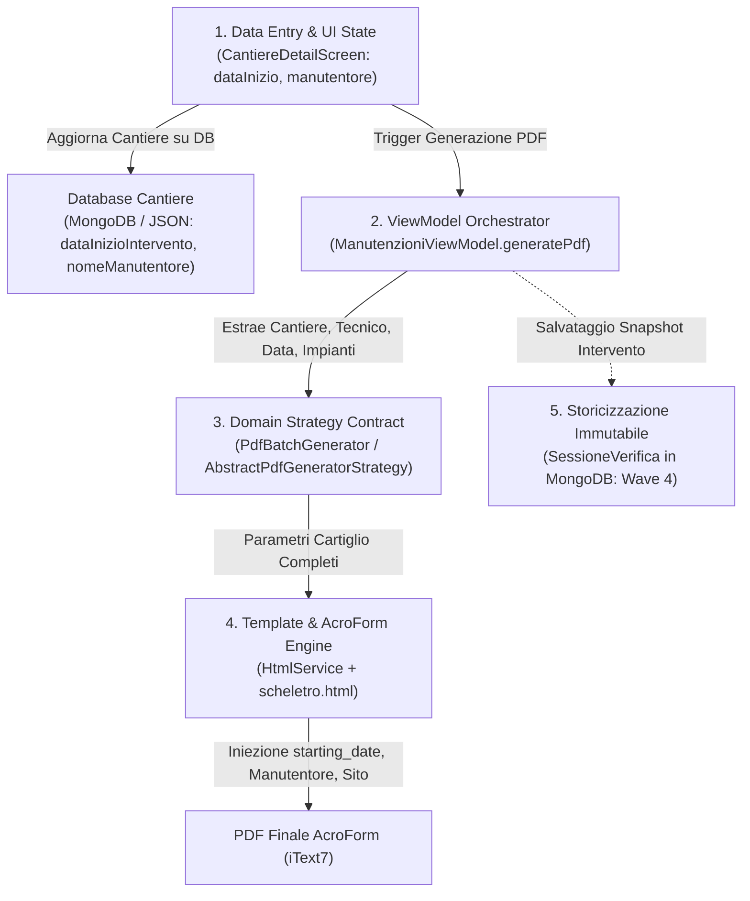

# 📋 ROADMAP REQUISITI CLIENTE, REFACTORING ARCHITETTURALE & PIANO BRANCH

> **Progetto:** Manutenzioni Maker (KMP Compose Desktop)  
> **Versione Documento:** 2.1 (Allineamento Nomenclatura `TechnicalAttachmentProvider` & UI Benchmark `EmergenzaAttachmentProvider`)  
> **Data:** 12 Ottobre 2026  
> **Target Branch Base:** `develop`  
> **Riferimento Architetturale:** [AGENTS.md](file:///Users/edoardo/development_prdj/fdf_builder/AGENTS.md)

---

## 1. 🎯 Obiettivo del Documento

Questo documento formalizza l'analisi tecnica, la classificazione e la strategia di implementazione per le **31 richieste e feedback operativi** emersi dalla revisione con la committenza tecnica.

In risposta all'esigenza fondamentale di applicare le **migliori pratiche di ingegneria del software (Clean Code, DRY, Open-Closed Principle)**, il piano adotta e consolida la nomenclatura esistente di **[TechnicalAttachmentProvider](file:///Users/edoardo/development_prdj/fdf_builder/desktopApp/src/desktopMain/kotlin/manutenzioni/domain/service/attachments/TechnicalAttachment.kt)**.  
L'interfaccia utente viene standardizzata estraendo come **componente Composable unico** la UX già implementata e apprezzata dal cliente in **[EmergenzaAttachmentProvider](file:///Users/edoardo/development_prdj/fdf_builder/desktopApp/src/desktopMain/kotlin/manutenzioni/app/service/attachments/EmergenzaAttachmentProvider.kt)** (elenco card, badge informativi, pulsanti inline di modifica/duplica/elimina, aggiunta massiva ed export Foglio 2), estendendola identicamente a tutti gli altri impianti (Quadri BT e Rilevazione Incendi).

---

## 2. 🏛️ Analisi di Dominio delle 31 Richieste

### A. Anagrafica, Navigazione & Wording Globale
* **Richiesta 1 — Tab Master:** Nella pagina Amministrazione, rinominare il tab *IMPIANTI LOCALI* in *MASTER SCHEDE DI VERIFICA*.
* **Richiesta 2 — Editing Completo Cliente:** In *Amministrazione -> Clienti*, il dialog di modifica (icona matita) deve permettere di modificare non solo la ragione sociale / nome, ma anche **Indirizzo** e **Partita I.V.A.**
* **Richiesta 3 — Indirizzo Cantiere:** In *Amministrazione -> Cantieri*, aggiungere il campo **Indirizzo del cantiere** in fase di creazione e modifica cantiere.
* **Richiesta 4 — Wording Accesso Operativo:** Nella *Dashboard Operativa* (selezione cliente), rinominare il pulsante *GESTISCI IMPIANTI* in *GESTIONE VERIFICHE PERIODICHE*.
* **Richiesta 5 — Wording Aggiunta Verifiche:** Nella dashboard del singolo cantiere, rinominare il pulsante *AGGIUNGI IMPIANTI* in *AGGIUNGI ATTIVITA DI VERIFICA*.
* **Richiesta 6 — Selezione Multipla Impianti:** Nella finestra di aggiunta attività di verifica (ex *Aggiungi Nuovo Impianto*):
  - Aggiungere caselle **checkbox** per la **selezione multipla** contestuale di più impianti con un solo click di conferma.
  - Allineare i testi e le etichette a sinistra (e non al centro).
* **Richiesta 12 — Wording Tab Generazione:** Nella dashboard del cantiere, rinominare il tab *Generazione PDF* in *Generazione schede di Verifica*.

---

### B. Quadri Elettrici BT (Bassa Tensione)
* **Richiesta 8 — Titolo Scheda Quadro nel PDF:** In fase di generazione, nella scheda del quadro elettrico non deve comparire la dicitura generica fissa *"Quadro Elettrico"*, ma la **descrizione specifica / nome completo** assegnato a quel quadro nel cantiere (es. *"Quadro Generale QG"*, *"Quadro Reparto Presse"*).
* **Richiesta 9 — Modifica Interruttore Quadro:** All'interno della scheda quadri del cantiere, deve essere possibile **modificare** i dati di un interruttore già censito (dialog di modifica con valori pre-caricati e salvataggio in place, esattamente come avviene per le lampade).
* **Richiesta 10 — Ordine e Validazione Campi Interruttore:** Nel form di compilazione interruttore:
  1. Primo campo: **Sigla** (es. *QA1*, *QG1*)
  2. Secondo campo: **Produttore** (es. *ABB*, *Schneider Electric*)
  3. Terzo e quarto campo: **Codice Articolo / Dati Interruttore** e **Taratura differenziale** (es. *0,03A-A*, *0,3A-AS*)
  4. Ultimo campo: **Descrizione / Note**, posizionato in fondo e **non vincolante** (opzionale).
* **Richiesta 11 — Tab ed Export Elenco Interruttori Cantiere:** Nella dashboard del cantiere, inserire sotto al tab schede un nuovo TAB denominato *"Elenco interruttori"*, con tabella riassuntiva di tutti gli interruttori del cantiere e pulsante dedicato per stampare il PDF dell'**Elenco complessivo interruttori differenziali** (Foglio 2 standalone via `QuadroBtAttachmentProvider`).
* **Richiesta 13 — Gerarchia Visiva Scheda Quadri:** Ristrutturare la UI della sezione quadri secondo la gerarchia apprezzata per l'emergenza:
  ```
  Scheda Quadri
    ├── Elenco Quadri (QG, Q1, Q2...)
    │     └── Componenti Quadro (Interruttori con card, badge, tasti modifica/duplica/elimina)
    └── Attività di verifica per quadri (Verifiche generali di quadro)
  ```
* **Richiesta 15 — Foglio 2 Differenziali Condizionale (6 Mesi vs 1 Anno):**
  - Se la periodicità della verifica è **6 Mesi** (`DIFF.06`): la tabella allegata degli interruttori differenziali **NON** deve mostrare la colonna *"Prova con strumento"*; include solo *"Dati Interruttore"*, *"Taratura diff."* e *"Prova con tasto"* (OK / NON OK).
  - Se la periodicità è **1 Anno** (`DIFF.1`): la tabella deve mostrare **entrambe** le prove: *"Prova con tasto"* (OK / NON OK) e *"Prova con strumento"* (OK / NON OK, Nr. Misura).

---

### C. Illuminazione di Emergenza (EM) & Sicurezza (IS)
* **Specificazione Architetturale Mandatoria:**  
  *IS e EM rappresentano lo stesso impianto fisico e normativo (UNI 11222).* I geometri usano a loro discrezione la dicitura **IS** (*Illuminazione di Sicurezza*) o **EM** (*Illuminazione di Emergenza*). I dati devono essere memorizzati **una sola volta nel DB master**, senza duplicazioni di collezioni o schede. A livello di cantiere, l'utente seleziona o imposta la sigla desiderata (`EM` o `IS`) e il sistema adegua automaticamente il codice e l'oggetto nel PDF.
* **Richiesta 7 — Aggiunta Lampade su IS:** Quando la scheda è denominata `IS`, il pulsante *"Aggiungi Lampade"* e il registro lampade devono essere attivi e visibili esattamente come su `EM`.
* **Richiesta 14 — Export Autonomo Registro Lampade:** Implementare un pulsante per l'esportazione diretta del PDF con l'**Elenco/Registro complessivo delle lampade di emergenza** (Foglio 2 standalone via `EmergenzaAttachmentProvider`).
* **Richiesta 16 — Allineamento Completo IS ↔ EM:** `normalizeType()` e l'intero engine trattano `IS` come alias funzionale di `ImpiantoEmergenza`, condividendo al 100% data model, dialog, attachment provider e logiche di calcolo.

---

### D. Quadro Media Tensione (QMT)
* **Richiesta 17 — Selettore Tecnologia Interruttore (SF6, ISV, IVOR):**
  - Nella scheda QMT deve essere presente un selettore per il tipo di interruttore MT: **SF6**, **ISV**, **IVOR**.
  - In base alla tipologia selezionata, l'elenco delle attività di verifica (da 1 a 21) adegua automaticamente le descrizioni (attività 11, 12, 14, 18, 19, 20, 21 specifiche per la tecnologia scelta).
  - La periodicità delle attività è distribuita su **1 Anno** (attività 1..12), **2 Anni** (attività 13..14) e **5 Anni** (attività 15..21), con le note specifiche relative alle prove a banco/cassetta relè e manutenzione del costruttore.
  - *Nota Inclusione Frequenze QMT:* Con intervento a **2 Anni** vengono stampate esattamente **14 attività** (12 da 1A + 2 da 2A, in conformità a `F % A == 0`). Le restanti 7 attività (15..21) hanno periodicità 5 Anni e vengono incluse con frequenza quinquennale.

---

### E. Rilevazione Incendi (RI) & Rilevazione Gas (RIG)
* **Richiesta 18 — Rivelazione Incendi (RI): Checkbox Componenti & Attività Dinamiche:**
  - Nella configurazione di RI, fornire una serie di **checkbox** per selezionare i dispositivi installati nell'impianto:
    1. *Rivelatori di Fumo Puntiformi*
    2. *Rivelatori di Fumo Lineari*
    3. *Rivelatori di Calore Puntiformi*
    4. *Rivelatori di Calore Lineari*
    5. *Rivelazione ad Aspirazione*
    6. *Rivelatori di condotta*
    7. *Rivelatori di Fiamma*
  - In fase di stampa, la periodicità base è sempre **6 Mesi**.
  - La scheda base include tassativamente le **10 attività istituzionali di centrale e linee**.
  - Per ciascuna delle tipologie selezionate dal checkbox, viene iniettata automaticamente nel PDF una riga di attività dedicata:  
    *`"Prova dei [Componente Selezionato] (prova sul 50% dell’impianto) impiegando dispositivi artificiali di produzione del fumo o di altro, simulando l'insorgere di un incendio"`*.
* **Richiesta 19 — Registro Componenti a Loop (LOOP 1..4):**
  - Possibilità di gestire l'elenco dettagliato dei componenti di rivelazione con numerazione suddivisa per **LOOP** (fino a 4 Loop) per sensori e moduli (`AntincendioAttachmentProvider` con Foglio 2 `ELENCO RIL.csv`).
* **Richiesta 20 — Rilevazione Gas (RIG):**
  - Mantenere l'impostazione attuale (confermata corretta dal cliente), garantendo estensibilità per futuri allineamenti.

---

### F. PDF Engine, Layout & File Management
* **Richiesta 21 — Multi-selezione Periodicità Batch:** In fase di generazione PDF dal cantiere, deve essere possibile selezionare **più di una periodicità contemporaneamente** per lo stesso impianto (es. stampare sia la 6 Mesi che l'Annuale per i quadri elettrici nello stesso ciclo batch).
* **Richiesta 22 — Naming Univoco File PDF:** Il nome del file PDF generato deve essere composto rigorosamente da:  
  `{SIGLA_QUADRO}_{PERIODICITA}.pdf` (es. `QG_06.pdf`, `Q1_06.pdf`, `QG_1.pdf`), evitando sovrascritture in cantieri con quadri multipli.
* **Richiesta 23 — Impaginazione Standardizzata a 30 Righe:**
  - Ogni scheda PDF deve essere generata sempre con una griglia fissa di **30 righe** (anche se in parte vuote) per garantire uniformità visiva millimetrica.
  - Standardizzare il codice periodicità nel cartiglio: a due cifre per i mesi (`01`, `02`, `03`, `06`) e a una cifra per gli anni (`1`, `2`, `5`).
  - Incrementare la dimensione del carattere nei campi testo/note per migliorare la leggibilità su tablet/cartaceo.
* **Richiesta 29 — Salvataggio in Sottocartella `YYYY_MM`:** L'esportazione batch deve creare automaticamente all'interno della cartella di destinazione una sottocartella temporale strutturata (es. `2026_10/`) contenente tutti i PDF dell'intervento.
* **Richiesta 32 — Stampa Fedele Colonna "Zona" nei PDF per tutti gli impianti:** Nei file CSV di catalogo ed esportati (es. `QMT.csv`, `TRFS.csv`, ecc.) è presente la colonna "Zona" associata a ciascuna attività (es. "Trasformatore", "Q.M.T.", "TA-TO-TV", "Interruttore", "SEZ.", ecc.). Il cliente richiede che nella griglia delle attività del PDF (Foglio 1), la colonna di dettaglio "Impianto" stampi fedelmente la dicitura della colonna "Zona" del CSV per ciascun impianto configurato, sia nei template globali che nelle istanze di cantiere.

---

### G. Metadati di Cantiere, Firma & Pianificazione
* **Richiesta 24 — Data Inizio Attività (Integrazione Cartiglio PDF):**
  - Campo editabile nella dashboard di cantiere (*"Data inizio periodo attività"*).
  - *Stato Attuale:* Il campo è presente nella UI di cantiere e persistito nel DB su `Cantiere.dataInizioIntervento`, **ma non viene attualmente propagato né stampato nel PDF**.
  - *Target Linea di Produzione:* In fase di generazione, il valore deve fluire attraverso la pipeline (ViewModel → Strategy → HtmlService) ed essere precompilato nel campo AcroForm `starting_date` del cartiglio.
* **Richiesta 25 — Tecnico / Verificatore (Storicizzazione & Stampa):**
  - Campo editabile nella dashboard di cantiere (*"Verificatore / Manutentore"*).
  - *Stato Attuale:* Il campo è editabile nella UI e salvato su `Cantiere.nomeManutentore`, **ma non viene agganciato né stampato nel PDF**.
  - *Requisito di Storicizzazione:* Il nome del manutentore non deve essere una proprietà effimera del cantiere (soggetta a sovrascrittura negli interventi successivi), ma deve essere **storicizzato per ciascuna sessione di verifica/intervento**, garantendo la conformità e la tracciabilità delle verifiche periodiche nel tempo.
  - *Target Linea di Produzione:* Riportare il nome del tecnico nel riquadro "Verificatore/Manutentore" del PDF e memorizzarlo immutabile nella sessione storicizzata.
* **Richiesta 26 — Firma Digitale Tecnico:** Possibilità di caricare/associare l'immagine della firma del tecnico, stampata nel riquadro firma di tutte le schede.
* **Richiesta 27 — Tab Calendario Scadenze:** Creare un tab o vista *"Calendario"* che, a partire dalla data di inizio attività e dalle frequenze degli impianti, calcola e visualizza le scadenze future dei controlli.
* **Richiesta 28 — Foglio di Riepilogo Generale Intervento:** Generare un documento PDF di sintesi (Master Checklist) con il riepilogo di tutte le attività eseguite e programmate in conformità con il calendario.

---

### H. Storicizzazione & Controllo Accessi (RBAC)
* **Richiesta 30 — Archivio Mensile Schede Compilate:** Salvataggio delle sessioni di verifica per mese/anno, con possibilità di richiamare i dati per consultazione o riapertura/modifica.
* **Richiesta 31 — Gestione Utenti & Permessi (RBAC):** Profilazione dell'accesso all'applicazione:
  - Ruolo **Admin**: Gestione anagrafiche master, creazione/cancellazione cantieri, template normative.
  - Ruolo **Tecnico**: Visualizzazione dei soli cantieri assegnati e compilazione/stampa schede.

---

## 3. 🧩 Best Practice Architetturali: Unificazione UI su `TechnicalAttachmentProvider`

### 3.1 Nomenclatura del Sistema: Consolidamento di `TechnicalAttachmentProvider`
Invece di introdurre nomenclature estranee, il sistema si basa sull'infrastruttura già presente in:
`manutenzioni.domain.service.attachments.TechnicalAttachmentProvider`

Ogni impianto con componenti strumentali secondari dispone del proprio provider specializzato:
1. **`EmergenzaAttachmentProvider`** → gestisce `listaLampade` di `ImpiantoEmergenza` (Foglio 2 `ELENCO EM`)
2. **`QuadroBtAttachmentProvider`** → gestisce `listaInterruttori` di `QuadroBT` (Foglio 2 `ELENCO DIFF`)
3. **`AntincendioAttachmentProvider`** → gestisce `listaDispositivi` di `RilevazioneAntincendio` (Foglio 2 `ELENCO RIL`)

### 3.2 Il Benchmark della UI: La UX di `EmergenzaAttachmentProvider`
Nel feedback del cliente (Richiesta 13), la gestione grafica di `EmergenzaAttachmentProvider` in `ImpiantoEditor.kt` è considerata **lo standard ideale**:
- Card contenitore con titolo e badge conteggio: `Lampade di Emergenza (N)`
- Pulsante rapido `Aggiungi Lampade`
- Pulsante `Svuota`
- Per ogni elemento della lista:
  - Badge prominente della Sigla (es. `EM-01`)
  - Produttore e Modello
  - Badge colorati con attributi chiave (Autonomia `⏱ 1h`, Posizione `📍 Corridoio`, Data batteria `🔋 2024-03-15`)
  - **Tasto Modifica** con matita (`Icons.Default.Edit`)
  - **Tasto Duplica Rapido** (`findNextSiglaForClone`) per clonare l'elemento incrementando la sigla
  - **Tasto Rimuovi** (`Icons.Default.Delete`)

Al contrario, nei Quadri BT l'implementazione era carente: mancava il tasto Modifica (Richiesta 9) e il tasto Clona, generando asimmetrie ed errori per gli operatori.

### 3.3 Il Refactoring Composable: `TechnicalAttachmentSection`
Creiamo un unico componente Composable standardizzato:
```kotlin
@Composable
fun <T> TechnicalAttachmentSection(
    title: String,
    subtitle: String,
    items: List<T>,
    itemTitle: (T) -> String,
    itemSubtitle: (T) -> String,
    badgeText: (T) -> String,
    extraBadges: @Composable RowScope.(T) -> Unit = {},
    onAddItem: () -> Unit,
    onEditItem: (T) -> Unit,
    onCloneItem: ((T) -> Unit)? = null,
    onDeleteItem: (T) -> Unit,
    onClearAll: (() -> Unit)? = null,
    onExportStandalonePdf: (() -> Unit)? = null
)
```

Questo singolo componente garantisce che:
1. **`QuadroBtAttachmentProvider`** eredita all'istante l'editing inline (R9), la clonazione rapida, e il pulsante per esportare l'elenco complessivo interruttori (R11).
2. **`EmergenzaAttachmentProvider`** beneficia dell'integrazione del pulsante di esportazione registro indipendente (R14) e del supporto per la sigla `IS` (R7, R16).
3. **`AntincendioAttachmentProvider`** riceve nativamente la stessa ricca interfaccia per censire i sensori e moduli dei 4 Loop senza riscrivere UI da zero (R19).

### 3.4 Linea di Produzione Documentale: Pipeline End-to-End Cantiere → PDF & Storicizzazione

Per sanare la discrepanza tra i dati inseriti nella GUI e la loro mancata inclusione nel PDF, la linea di produzione documentale viene strutturata in 5 stadi a responsabilità singola:



#### I 5 Stadi della Catena di Produzione:
1. **Stadio 1 — Data Entry & UI State (`CantiereDetailScreen`):**
   - L'operatore inserisce `Data inizio periodo Attività` e `Verificatore/Manutentore`.
   - Il cantiere viene persistito nel DB locale/remoto.
2. **Stadio 2 — ViewModel Orchestration (`ManutenzioniViewModel`):**
   - `generatePdf()` non legge solo `selectedCliente?.nome`, ma estrae dal cantiere attivo (`state.selectedCantiere`): `nome` (Sito), `dataInizioIntervento`, `nomeManutentore`.
3. **Stadio 3 — Domain Strategy Contract (`PdfBatchGenerator` / `AbstractPdfGeneratorStrategy`):**
   - La firma di generazione viene estesa per accettare i metadati di cantiere:
     `cantiereNome: String? = null, dataInizioIntervento: String? = null, nomeManutentore: String? = null`.
4. **Stadio 4 — Template Engine & AcroForm Precompilation (`HtmlService` + `scheletro.html`):**
   - Cartiglio *"Sito"*: Popolato con il nome del cantiere.
   - Campo AcroForm *"Data inizio periodo Attività"* (`starting_date`): Precompilato con `dataInizioIntervento`.
   - Cella *"Verificatore/Manutentore"*: Popolata con `nomeManutentore`.
   - Riquadro *"Firma"*: Predisposto per binding immagine firma digitale.
5. **Stadio 5 — Storicizzazione Immutabile (`SessioneVerifica` - Wave 4):**
   - Ad ogni ciclo di stampa/generazione schede, viene registrata una `SessioneVerifica` immutabile contenente lo snapshot della data, del tecnico che ha eseguito la manutenzione e l'elenco dei PDF prodotti, garantendo la conservazione dello storico degli operatori nel tempo.

---

## 4. 🌲 Suddivisione in Branch di Produzione

Lo sviluppo viene organizzato in **4 Onde (Waves)** e **11 Branch di Produzione**.  
Il branch **`refactor/technical-attachment-ui-unification`** è posto come fondazione all'inizio di Wave 2.

```
develop
  │
  ├── [WAVE 1: Quick-Wins & Anagrafica Master]
  │     ├── 🌿 feat/admin-anagrafica-and-wording       [R1, R2, R3, R4, R5, R12]
  │     └── 🌿 feat/cantiere-selection-multi          [R6]
  │
  ├── [WAVE 2: Technical Attachments & Domini Impianti]
  │     ├── 🔧 refactor/technical-attachment-ui-unification [Unificazione UI su Emergenza Benchmark]
  │     ├── 🌿 feat/quadri-bt-lifecycle-and-diff      [R8, R9, R10, R13, R15] (adotta la UI unificata)
  │     ├── 🌿 feat/emergenza-is-unification          [R7, R14, R16] (allineamento IS/EM + export Foglio 2)
  │     ├── 🌿 feat/qmt-switch-types-activities       [R17]
  │     └── 🌿 feat/antincendio-loop-registry         [R18, R19, R20] (adotta la UI unificata)
  │
  ├── [WAVE 3: Cantiere Workflow & PDF Batch Engine]
  │     ├── 🌿 feat/cantiere-metadata-and-signature   [R24, R25, R26]
  │     └── 🌿 feat/pdf-batch-multifreq-naming-layout  [R11, R21, R22, R23, R29]
  │
  └── [WAVE 4: Calendario, Storicizzazione & RBAC]
        ├── 🌿 feat/calendario-scadenze-riepilogo     [R27, R28]
        └── 🌿 feat/storicizzazione-and-rbac          [R30, R31]
```

---

## 5. 📝 Check-List Operativa di Dettaglio per Singolo Branch

---

### 🌊 WAVE 1: Quick-Wins & Anagrafica Master

#### 🌿 Branch 1: `feat/admin-anagrafica-and-wording`
* **Richieste coperte:** `1`, `2`, `3`, `4`, `5`, `12`
- [ ] **Domain Model:** Verificare campo `indirizzo: String? = null` in `Cantiere` ([ManutenzioneModels.kt](file:///Users/edoardo/development_prdj/fdf_builder/desktopApp/src/desktopMain/kotlin/manutenzioni/domain/model/ManutenzioneModels.kt)).
- [ ] **Repository Layer:** Verificare persistenza e serializzazione dell'indirizzo cantiere in `MongoManutenzioneRepository` e `JsonManutenzioneRepository`.
- [ ] **UI Admin Dashboard:** Rinominare tab in *"MASTER SCHEDE DI VERIFICA"* in `AdminDashboardScreen.kt`.
- [ ] **UI Admin Clienti:** Nel dialog di modifica di `AdminClientiTab.kt`, aggiungere campi editabili per `indirizzo` e `partitaIva`.
- [ ] **UI Admin Cantieri:** Nel dialog di aggiunta/modifica cantiere di `AdminCantieriTab.kt`, aggiungere campo `indirizzo`.
- [ ] **UI Operatività:** Rinominare pulsante cliente in *"GESTIONE VERIFICHE PERIODICHE"* in `OperativitaScreen.kt`.
- [ ] **UI Dettaglio Cantiere:** Rinominare pulsante in *"AGGIUNGI ATTIVITA DI VERIFICA"* e tab in *"Generazione schede di Verifica"* in `CantiereDetailScreen.kt`.
- [ ] **Testing:** Eseguire `CantiereSerializationTest` e verificare navigazione.

#### 🌿 Branch 2: `feat/cantiere-selection-multi`
* **Richieste coperte:** `6`
- [ ] **UI State:** In `NuovoImpiantoDialog.kt`, aggiungere stato reattivo `selectedImpiantoIds: Set<String>`.
- [ ] **Layout Dialog:** Sostituire selezione singola con elenco dotato di Checkbox multi-selezione.
- [ ] **Allineamento:** Impostare allineamento orizzontale a sinistra dei titoli e codici delle attività.
- [ ] **ViewModel:** Aggiornare azione di salvataggio per inserire in blocco tutti gli impianti selezionati nel cantiere corrente.
- [ ] **Testing:** Test di aggiunta simultanea di 3+ impianti al cantiere.

---

### 🌊 WAVE 2: Technical Attachments & Domini Specialistici Impianti

#### 🔧 Branch 2.1: `refactor/technical-attachment-ui-unification`
* **Obiettivo Architetturale:** Creare il componente Composable universale basato sul benchmark di `EmergenzaAttachmentProvider`.
- [x] **UI Component Riusabile:**
  - [x] Creare `TechnicalAttachmentSection<T>` con header (titolo, conteggio, aggiungi, svuota).
  - [x] Supportare card elemento con badge sigla, dettagli, badge ausiliari e bottoni standard (Modifica matita, Clona rapido, Elimina cestino).
  - [x] Includere pulsante opzionale *"Esporta Foglio Tecnico PDF"* (Foglio 2 standalone).
- [x] **Helper di Clonazione Sigla:**
  - [x] Generalizzare `LampadaGeneratorHelper.findNextSiglaForClone` per funzionare con qualsiasi prefisso/sigla (interruttori `QA1` -> `QA2`, sensori `RIV.L1.1` -> `RIV.L1.2`).
- [x] **Testing:** Test di anteprima grafica Composable con fixture di test.

#### 🌿 Branch 3: `feat/quadri-bt-lifecycle-and-diff`
* **Richieste coperte:** `8`, `9`, `10`, `13`, `15` *(usa `TechnicalAttachmentSection`)*
- [x] **UI Quadri BT Refactoring:** Sostituire la card custom dei quadri con `TechnicalAttachmentSection<InterruttoreBT>`, abilitando nativamente **Modifica** (R9) e **Clona**.
- [x] **Cartiglio PDF Quadro:** Garantire che [QuadroBT](file:///Users/edoardo/development_prdj/fdf_builder/desktopApp/src/desktopMain/kotlin/manutenzioni/domain/model/ManutenzioneModels.kt#L57-L82) stampi la `descrizioneQuadro` / sigla specifica e non il placeholder fisso "Quadro Elettrico" (R8).
- [x] **Form Interruttore (`AggiungiComponenteDialog`):**
  - [x] Campo 1: `Sigla`
  - [x] Campo 2: `Produttore`
  - [x] Campo 3 e 4: `Codice/Dati Articolo` e `Taratura differenziale`
  - [x] Campo finale: `Descrizione/Note` (opzionale, non vincolante alla validazione) (R10).
- [x] **Gerarchia Visiva UI:** Riorganizzare visualizzazione ad albero: Scheda Quadri -> Elenco Quadri -> Componenti Quadro + Attività quadro (R13).
- [x] **Foglio 2 Condizionale (`QuadroBtAttachmentProvider`):**
  - [x] Frequenza `6 Mesi`: escludere colonna *"Prova con strumento"*; mantenere solo *"Prova con tasto"* (R15).
  - [x] Frequenza `1 Anno`: includere sia *"Prova con tasto"* che *"Prova con strumento"* (misura tempo/corrente).
- [x] **Testing:** Test di generazione PDF 6M vs 1A con confronto colonne differenziali.

#### 🌿 Branch 4: `feat/emergenza-is-unification`
* **Richieste coperte:** `7`, `14`, `16` *(usa `TechnicalAttachmentSection`)*
- [x] **Single Source of Truth:** Assicurare che nel DB esista una sola scheda master per l'illuminazione di emergenza/sicurezza.
- [x] **Domain Normalization:** Aggiornare `normalizeType()` per gestire sia `EM` che `IS` come `ImpiantoEmergenza` (R16).
- [x] **Selettore Sigla Cantiere:** Aggiungere nell'editor/scheda cantiere il selettore della sigla documentale (`EM` vs `IS`).
- [x] **UI Registro Lampade:** Attivare `TechnicalAttachmentSection` sia quando il codice è `EM` sia quando è `IS` (R7).
- [x] **Export Registro Lampade (UNI 11222):** Collegare il pulsante di export della section al provider [EmergenzaAttachmentProvider](file:///Users/edoardo/development_prdj/fdf_builder/desktopApp/src/desktopMain/kotlin/manutenzioni/app/service/attachments/EmergenzaAttachmentProvider.kt) (R14).
- [x] **Testing:** Test di cambio sigla da EM a IS senza perdita del registro lampade.

#### 🌿 Branch 5: `feat/qmt-switch-types-activities`
* **Richieste coperte:** `17`
- [x] **Domain Enum:** Aggiornare [MqtSwitchType](file:///Users/edoardo/development_prdj/fdf_builder/desktopApp/src/desktopMain/kotlin/manutenzioni/domain/model/ManutenzioneModels.kt#L196-L201) con i valori `SF6`, `ISV`, `IVOR`.
- [x] **Catalogo Attività QMT:** Integrare le 21 attività e periodicità (1, 2, 5 anni) da `Fogli_Esportati_CSV/QMT copy.csv` ripulito da doppioni, con colonna "zona" impostata a "Interruttore".
- [x] **UI Selettore Interruttore:** Aggiungere selettore Radio in `ImpiantoEditor` e nella scheda cantiere `CantiereDetailScreen` per scegliere tra SF6, ISV e IVOR.
- [x] **Risolutore Attività Dinamiche:** Sostituzione dinamica della keyword "Interruttore" nella colonna "zona" delle attività (11, 12, 14, 18, 19, 20, 21) con la tecnologia scelta sia a livello di cantiere nel DB sia nel PDF via `HtmlService`.
- [x] **Testing:** Verifica coerenza delle 21 attività, inclusione frequenze e rendering PDF.

#### 🌿 Branch 6: `feat/antincendio-loop-registry`
* **Richieste coperte:** `18`, `19`, `20` *(usa `TechnicalAttachmentSection`)*
- [x] **Checkbox Componenti RI:** Aggiungere mappa di booleani per le 7 categorie di rivelatori in `RilevazioneAntincendio` (R18).
- [x] **Generazione Attività 6M:**
  - [x] Includere sempre le 10 attività istituzionali di centrale e linee.
  - [x] Aggiungere riga dinamica di verifica al 50% per ogni componente con checkbox attiva.
- [x] **Registro Loop 1..4 (`ELENCO RIL.csv`):**
  - [x] Creare `DispositivoRilevazione` (Loop 1..4, Indirizzo, Tipo, Installazione, Descrizione, Zona) (R19).
  - [x] Collegare alla `TechnicalAttachmentSection` per censimento dispositivi e moduli.
  - [x] Implementare `AntincendioAttachmentProvider : TechnicalAttachmentProvider` per generare il Foglio 2 `ELENCO RIL`.
- [x] **Guardrail RIG:** Verificare che `RilevazioneGas` rimanga stabile e compatibile (R20).
- [x] **Testing:** Test generazione scheda RI a 6 mesi con combinazioni di 1, 3 e 7 categorie di rivelatori.

---

### 🌊 WAVE 3: Cantiere Workflow & PDF Batch Engine

#### 🌿 Branch 7: `feat/cantiere-metadata-and-signature`
* **Richieste coperte:** `24`, `25`, `26`
- [x] **Domain Model & Data Persistence:** Campi `dataInizioIntervento` e `nomeManutentore` definiti in `Cantiere` e testati in `CantiereSerializationTest`.
- [x] **UI Dettaglio Cantiere (Data Entry):** Form in `CantiereDetailScreen.kt` per inserimento data inizio e nome manutentore salvati sul database.
- [x] **Collegamento Linea di Produzione PDF (ViewModel → Strategy):**
  - [x] Aggiornare `PdfBatchGenerator.generateBatch` e `AbstractPdfGeneratorStrategy.generate` introducendo i metadati di cantiere:
    `cantiereNome: String? = null, dataInizioIntervento: String? = null, nomeManutentore: String? = null`.
  - [x] In `ManutenzioniViewModel.generatePdf`, estrarre dal cantiere selezionato (`state.selectedCantiere`) i valori di `nome` (Sito), `dataInizioIntervento` e `nomeManutentore` e passarli a `pdfStrategy.generateBatch`.
- [x] **HtmlService & AcroForm Precompilation:**
  - [x] In `scheletro.html`, iniettare il nome cantiere nel campo `<p>Sito: <!-- SITO --></p>`.
  - [x] In `scheletro.html`, precompilare il campo AcroForm `starting_date` con il valore di `dataInizioIntervento`.
  - [x] In `scheletro.html`, popolare la cella `Verificatore/Manutentore` con `nomeManutentore`.
  - [x] In `HtmlService.kt`, implementare la sostituzione dei relativi placeholder.
- [x] **Firma Digitale Tecnico:** Configurare pulsante caricamento immagine firma nella dashboard di cantiere e binding nel riquadro firma del PDF (R26).
- [x] **Testing End-to-End:** Test automatico che genera un PDF da un cantiere con dati intervento e verifica che i campi AcroForm e il cartiglio contengano i dati inseriti.

#### 🌿 Branch 8: `feat/pdf-batch-multifreq-naming-layout`
* **Richieste coperte:** `11`, `21`, `22`, `23`, `29`, `32`
* **Strategia di esecuzione:** Suddivisa in 2 sotto-fasi operative sequenziali per separare la standardizzazione del layout del Foglio 1 dalla logica batch.

##### 🔹 Sotto-Fase 8.1: Layout Foglio 1, 30 Righe & Dati Zona (`R23`, `R32`)
- [x] **Sincronizzazione Dati Catalogo da CSV (R32):**
  - [x] Eseguire migrazione/script di parsing da tutti i file in `Fogli_Esportati_CSV/*.csv` (`FTV.csv`, `CAB MT.csv`, `TRFS.csv`, `UPS.csv`, `GE.csv`, ecc.) per estrarre la colonna 4 (*"Zona"*).
  - [x] Popolare fedelmente il campo `zona` in ogni attività dei template globali in `manutenzioni_db.json` e nel database MongoDB (copertura 100% per tutti gli impianti).
- [x] **Allineamento Intestazione HTML (R32):**
  - [x] In `scheletro.html` (L391-L393), rinominare l'intestazione della colonna da `<p>Impianto</p>` a `<p>Zona</p>` per riflettere con esattezza il dato visualizzato.
- [x] **Risoluzione & Fallback Colonna Zona in `HtmlService` (R32):**
  - [x] In `HtmlService.kt` (`buildAttivitaRows`), rimuovere il fallback su `att.frequenza.label()`.
  - [x] Stampare `att.zona` prioritariamente (con gestione speciale tipo interruttore per `QuadroMQT`). In caso di valore vuoto/nullo, fallback su stringa vuota o nome dell'impianto.
- [x] **Impaginazione Fissa a 30 Righe (R23):**
  - [x] In `HtmlService.kt` (`buildAttivitaRows`), calcolare le righe mancanti: se il totale attività filtrate $N < 30$, generare $30 - N$ righe `<tr>` neutre di riempimento (con celle disabled/non compilabili).
  - [x] Ottimizzare font size e interlinea per garantire la perfetta impaginazione su foglio singolo A4 millimetrico.
- [x] **Formattazione Periodicità nel Cartiglio (R23):**
  - [x] Standardizzare il codice periodicità stampato nel cartiglio: a due cifre per i mesi (`01`, `02`, `03`, `06`) e a una cifra per gli anni (`1`, `2`, `5`).

##### 🔹 Sotto-Fase 8.2: Multi-frequenza Batch, Naming & File Management (`R11`, `R21`, `R22`, `R29`)
- [x] **Multi-selezione Frequenze nella UI di Cantiere (R21):**
  - [x] In `CantiereDetailScreen.kt`, consentire all'utente di selezionare più periodicità simultaneamente per ciascun impianto (es. sia 6M che 1A per i quadri).
- [x] **Batch Generator Loop Multi-frequenza (R21):**
  - [x] Aggiornare `AbstractPdfGeneratorStrategy.generateBatch` e `ManutenzioniViewModel` per ciclare su tutte le frequenze selezionate per ciascun impianto del cantiere.
- [x] **Naming Univoco File PDF (R22):**
  - [x] Generare i file con formato rigoroso: `{SIGLA_QUADRO}_{PERIODICITA}.pdf` (es. `QG_06.pdf`, `Q1_06.pdf`, `QG_1.pdf`), prevenendo sovrascritture.
- [x] **Salvataggio in Sottocartella Temporale `YYYY_MM` (R29):**
  - [x] Creare automaticamente la sottocartella basata sulla data inizio intervento o corrente (es. `2026_10/`) nel path di esportazione selezionato dall'utente.
- [x] **Tab & Export Elenco Interruttori Cantiere (R11):**
  - [x] Inserire vista aggregata di tutti gli interruttori dei quadri del cantiere con pulsante di esportazione dedicato.
- [x] **Testing End-to-End:**
  - [x] Verificare che un cantiere con più quadri generi la cartella corretta con file denominati `{SIGLA}_{PERIODICITA}.pdf`.
  - [x] Verificare con iText che ogni PDF generato contenga esattamente 30 righe nella tabella attività e riporti la dicitura corretta nella colonna "Zona".

---

### 🌊 WAVE 4: Pianificazione, Storico & Sicurezza

#### 🌿 Branch 9: `feat/calendario-scadenze-riepilogo`
* **Richieste coperte:** `27`, `28`
- [ ] **Scheduler Engine:** Implementare funzione di dominio che calcola le date delle future verifiche da `dataInizioIntervento` + frequenze.
- [ ] **UI Tab Calendario:** Creare schermata con timeline / calendario delle scadenze raggruppate per mese (R27).
- [ ] **Foglio di Riepilogo Generale:** Creare nuovo renderer per il PDF di riepilogo complessivo dell'intervento di cantiere (R28).
- [ ] **Testing:** Test di calcolo scadenze su cantieri con interventi misti (1M, 6M, 1A, 5A).

#### 🌿 Branch 10: `feat/storicizzazione-and-rbac`
* **Richieste coperte:** `30`, `31`
- [ ] **Storicizzazione Verifiche & Registro Manutentori:**
  - [ ] Creare entità `@Serializable data class SessioneVerifica(id, cantiereId, dataInizioIntervento, nomeManutentore, dataCreazione, elencoFilePdf: List<String>)` per memorizzare snapshot immutabili di ciascun ciclo di manutenzione (R30).
  - [ ] Garantire che il nome del manutentore inserito per un ciclo non venga sovrascritto o perso negli interventi successivi, ma rimanga storicizzato nello storico verifiche del cantiere (R25, R30).
- [ ] **UI Storico Cantiere:** Lista delle sessioni pregresse con possibilità di consultare il registro manutentori passati e scaricare/riaprire i fogli PDF associati.
- [ ] **RBAC Domain Model:** Entità `Utente` con ruoli `ADMIN` e `TECNICO` (R31).
- [ ] **Filtraggio Permessi UI:** 
  - Utente Tecnico: accesso limitato ai propri cantieri assegnati, sola compilazione schede.
  - Utente Admin: visibilità totale su anagrafiche, master e configurazioni.
- [ ] **Testing:** Test di persistenza e richiamo della sessione storicizzata con verifica del manutentore associato.

---

## 6. 🛡️ Definition of Done (Criteri di Qualità e Merge)

Prima del merge di ciascun branch in `develop`:
1. **Compilazione Desktop:**  
   `./gradlew :desktopApp:compileKotlinDesktop` deve terminare con `BUILD SUCCESSFUL`.
2. **Suite di Test:**  
   `./gradlew :desktopApp:test` deve superare tutti i test di regressione.
3. **Rispetto dei Guardrail di Progetto:**  
   - Nessun import di `manutenzioni.app.*` all'interno del package `manutenzioni.domain.*`.
   - Formula inclusione periodica `F.inMesi() % A.inMesi() == 0` preservata intatta.
   - Tutti i model persistiti devono essere annotati con `@Serializable` e avere valori di default.
   - I file PDF AcroForm generati devono aprirsi correttamente e consentire la compilazione dei campi interattivi.
